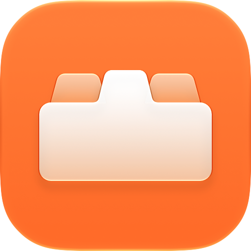
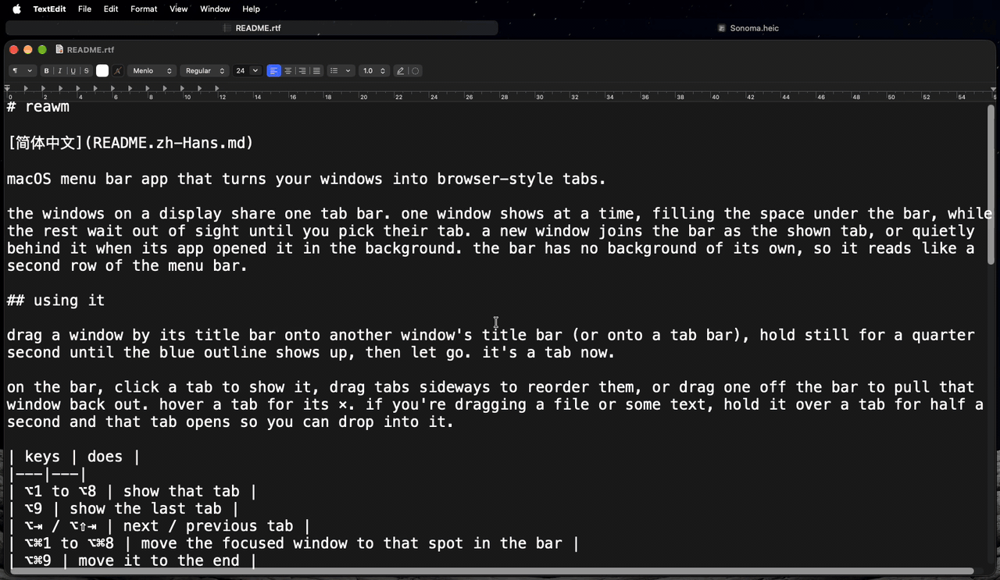

# reawm

[english](README.md)

macOS 菜单栏 app，把你的窗口变成浏览器式的标签页。



同一块显示器上的窗口共用一条标签栏。每次只显示一个窗口，占满标签栏下面的空间，其余的窗口藏在看不见的地方，等你选它们的标签页。新窗口会加到你当前标签页的右边，成为当前显示的标签页；如果是它的 app 在后台打开的，就悄悄放在它后面。标签栏本身没有背景，所以看起来就像菜单栏的第二行。

## 用法

按住一个窗口的标题栏，把它拖到另一个窗口的标题栏上（或者拖到标签栏上），停住四分之一秒，等蓝色边框出现，然后松手。它就变成标签页了。

在标签栏上，点一下标签页就会显示它，左右拖动标签页可以调整顺序，把一个标签页拖出标签栏就能把那个窗口重新拉出来。把鼠标移到标签页上就能看到它的 ×，也可以像浏览器一样用鼠标中键点它来关掉。如果你正在拖文件或一段文字，在某个标签页上停半秒，那个标签页就会打开，你就能放进去了。

想把当前显示的窗口拿出标签栏，就按住 ⌥⌘ 拖它的标题栏。在哪里松手，它就重新变回一个独立的窗口；在另一个窗口的标题栏或另一条标签栏上松手，它就加入那一条。

| 按键 | 作用 |
|---|---|
| ⌥1 到 ⌥8 | 显示对应的标签页 |
| ⌥9 | 显示最后一个标签页 |
| ⌥⇥ / ⌥⇧⇥ | 下一个 / 上一个标签页 |
| ⌥⌘1 到 ⌥⌘8 | 把当前聚焦的窗口移到标签栏的对应位置 |
| ⌥⌘9 | 把它移到最后 |

对浮动窗口用 ⌥⌘ 快捷键，会把它放进标签栏的对应位置。

用 ⌘-tab 切到某个 app 时，会显示它的窗口。把当前显示的窗口最小化，整条标签栏都会一起最小化；在程序坞里点它，标签栏就回来了。窗口进入全屏时，会把位置让给你之前看的那个标签页，桌面上的标签栏还在；退出全屏后，它再把位置拿回来。

其他功能都在菜单栏图标里：标签栏放在顶部、左边还是右边，哪些显示器有标签栏（全部、只有主显示器，或者你勾选的那几个），“tab every window”开关，给最前面的 app 设“no tabs”，还有暂停和退出。

## 怎么隐藏窗口

macOS 没法只隐藏某个 app 的单个窗口，所以 reawm 会把隐藏的标签页移到屏幕底角外面，只留一个点露在屏幕上。退出或暂停时，每个窗口都会回到它加入标签栏之前的位置。

不能全屏的窗口，比如系统设置或计算器，不会进标签栏，还是照常在最上层打开。其中能调整大小的，你还是可以自己拖到标签栏上。

## 构建

```
./scripts/bundle.sh
```

需要 Xcode 26 或更高版本，用来编译 Liquid Glass 图标；脚本会用它找到的第一个 `/Applications/Xcode*.app`。app 本身在 macOS 14 或更高版本上就能运行；macOS 26 之前显示的是预先渲染好的图标。它会构建出 `build/reawm.app`，如果你有 Apple Development 证书，就用它来签名，这样重新构建后 macOS 还会保留辅助功能权限。没有证书的话会用 ad hoc 签名，每次构建完你都得重新允许访问。

## 安装

从[最新版本](https://github.com/jxherc/reawm/releases/latest)下载 zip，解压后把 `reawm.app` 拖进 `/Applications`。如果是自己构建的，就把 `build/reawm.app` 拷过去。它在 Apple 芯片的 Mac 上运行。

下载的版本没有经过公证，所以第一次打开时 macOS 会拒绝。去系统设置 → 隐私与安全性，往下翻到关于 reawm 的那一行，点“仍要打开”；或者运行一次 `xattr -dr com.apple.quarantine /Applications/reawm.app`。

然后它会打开系统设置里允许控制这台 Mac 的 app 列表（隐私与安全性 → 辅助功能，macOS 27 里改了名字，英文叫 Device Control and Data Access）。在那里打开 reawm 的开关；如果列表里没有它，就点 + 把它加进去。移动其他 app 的窗口需要这个权限。你一允许，它就马上开始工作。

## 脚本

`open reawm://next` 能在脚本或启动器里执行一条命令。其他命令还有 `prev`、`tab?n=3`、`put?n=3`、`pause` 和 `resume`。

## 已知问题

- ⌥1 到 ⌥9 是全局快捷键，所以在所有 app 里，这几个键都打不出 ™、£ 和 • 了。
- 会独占整个键盘的 app（iPhone 镜像、虚拟机、远程桌面）在最前面时，会把这些快捷键吞掉。
- 如果 reawm 崩溃了，隐藏的标签页会一直停在角落里，直到你重新打开它。
- 只在窗口出现在屏幕上时才绘制的 app（比如虚拟机的窗口）变成隐藏的标签页后会卡住不动。在菜单里给它们设“no tabs”就行。
- `~/Library/Logs/reawm.log` 会记录每次切换和切换的原因，感觉哪里不对劲时会很有用。

## 许可证

MIT
